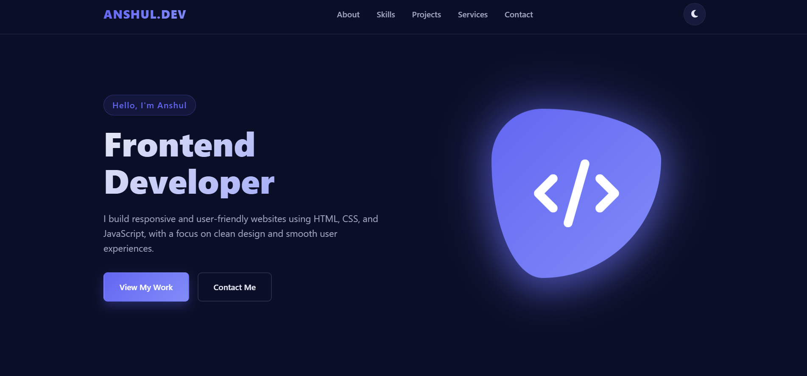

Anshul Kukreti — Frontend Developer

Hi! 👋 I'm Anshul, a frontend developer learning to build responsive and interactive websites using modern web technologies.

🚀 About Me

- 💻 Interested in frontend web development.
- 🌱 Currently improving my skills in HTML, CSS, and JavaScript.
- 🎯 Focused on building responsive and user-friendly websites.
- 📚 Exploring new technologies and developing practical projects.

🛠️ Technologies

- HTML5
- CSS3
- JavaScript
- Git & GitHub
- Visual Studio Code

📂 Projects

1. War of Elements

An interactive game featuring elemental powers and score tracking.

2. Quiz App

A quiz application with multiple-choice questions, score tracking, and a progress indicator.

3. To-Do List

A task management application for organizing everyday tasks.

4. Netflix Clone

A frontend practice project inspired by Netflix's interface.

5. YouTube Clone

A frontend practice project inspired by YouTube's interface.

📬 Contact

- GitHub: "anshul-kukreti" (https://github.com/anshul-kukreti)
- Email: kukretianshul07@gmail.com

---

⭐ Thanks for visiting my portfolio repository!
